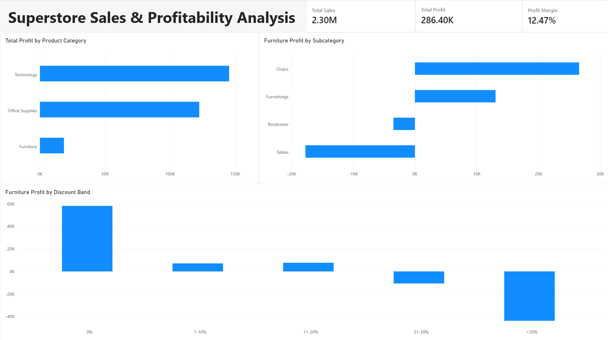

Superstore Sales & Profitability Analysis

Tools: Microsoft Excel · Power BI
Project type: Exploratory sales and profitability analysis
Dataset: Sample Superstore retail transaction data
Overview
This project examines sales, profit, and discount patterns in a sample retail dataset. I used Excel to investigate category and subcategory performance, then built a Power BI dashboard to present the results.

Business question: Why does the Furniture category generate substantial sales but relatively little profit, and which products and discount levels deserve closer review?
Dashboard
The Power BI report includes:
- Total Sales, Total Profit, and Overall Profit Margin KPI cards
- Total Profit by Product Category to compare performance across Furniture, Office Supplies, and Technology
- Furniture Profit by Subcategory to identify profitable and loss-making product groups
- Furniture Profit by Discount Band to examine the relationship between discounts and profitability
- 

Key findings
Finding	Result
Overall sales	Approximately $2.30 million
Overall profit	Approximately $286,400
Overall profit margin	Approximately 12.47%
Furniture sales	Approximately $742,000
Furniture profit margin	2.49%
Tables total profit	Approximately -$17,725
Bookcases total profit	Approximately -$3,473
Furniture profit in the >30% discount band	Approximately -$43,782

- Furniture underperformed other categories. Its 2.49% profit margin was far below Office Supplies (approximately 17.03%) and Technology (approximately 17.40%).
- Losses were concentrated in specific subcategories. Tables and Bookcases were unprofitable overall, while Chairs and Furnishings generated positive profit.
- Deep discounts were associated with large losses. Within Furniture's greater-than-30% discount band, Tables and Bookcases accounted for approximately $37,838, or 86.4%, of the band’s net loss.
Approach
1. Reviewed the transaction-level Superstore dataset and identified key fields, including Category, Sub-Category, Sales, Profit, and Discount.
2. Built Excel PivotTables to compare sales and profit across categories, furniture subcategories, and discount bands.
3. Calculated profit margin as total profit / total sales rather than averaging individual profit percentages.
4. Identified the subcategories contributing most to losses in heavily discounted Furniture transactions.
5. Imported the original transaction data into Power BI and created a one-page report with KPI cards and three charts.
Business recommendation
Prioritize a review of deep discounting on Tables and Bookcases. These subcategories contribute disproportionately to losses among Furniture transactions discounted above 30%.

A practical next step would be to test lower discount caps on a limited set of products and monitor unit sales, revenue, profit, and profit margin before expanding the policy.

Important limitation: The analysis shows an association between discount levels and profitability, not proof that discounts alone cause the losses. Product mix, costs, and customer demand may also affect results. Reducing discounts could reduce sales volume. A pricing scenario model was explored separately but is not presented here as a validated forecast.
Repository files
File:	Purpose
README.md	- Project background, methods, findings, and recommendation
Superstore_Profitability_Analysis.pbix	- Power BI report 
dashboard.png	- Preview of the finished Power BI report
Excel analysis workbook - Supporting PivotTables and calculations

How to view the report
1. Install Power BI Desktop on Windows.
2. Download Superstore_Profitability_Analysis.pbix from this repository after it has been uploaded.
3. Open the file in Power BI Desktop.
This is a portfolio project using sample retail data, not analysis of a real company's confidential sales records.
